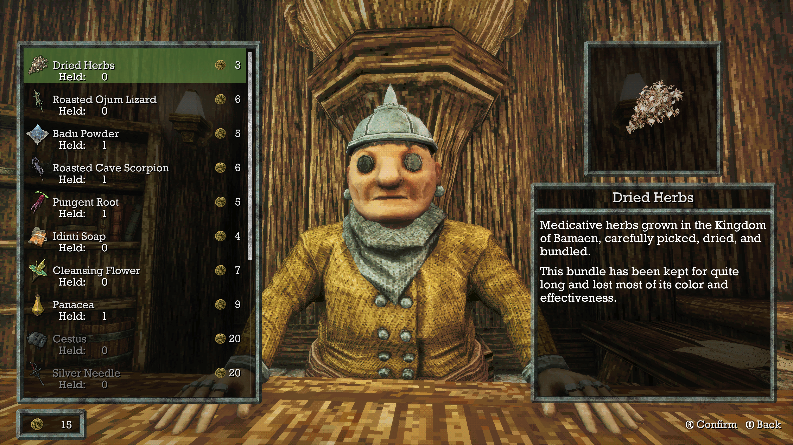
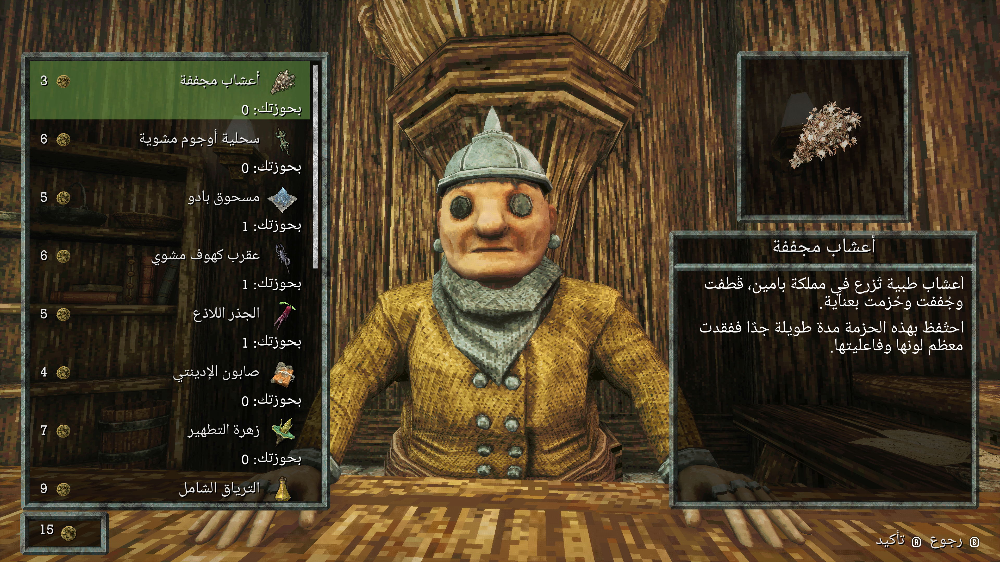
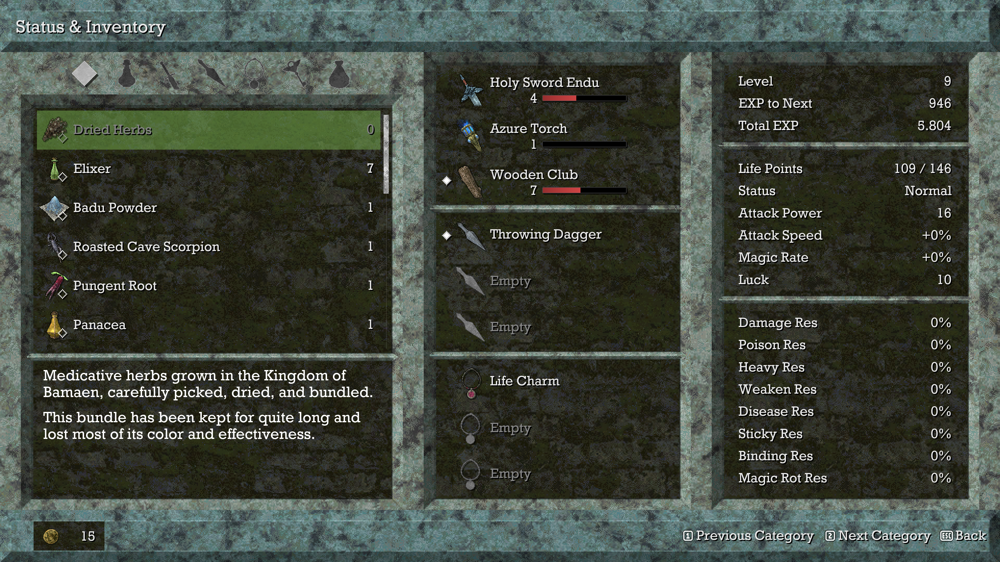
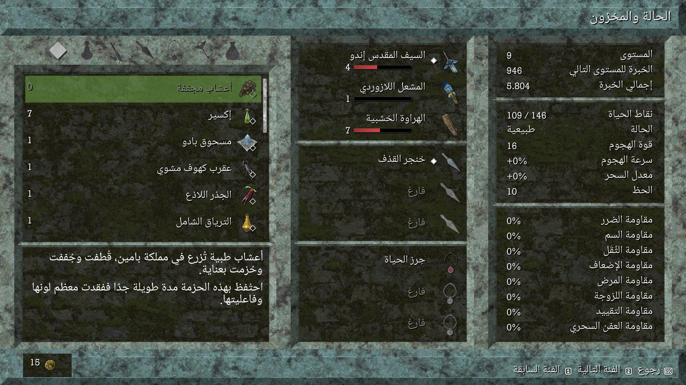
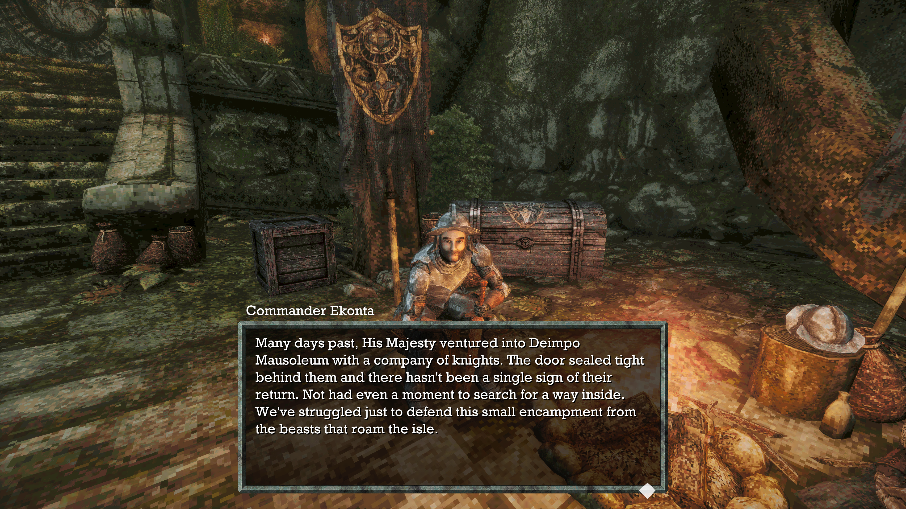
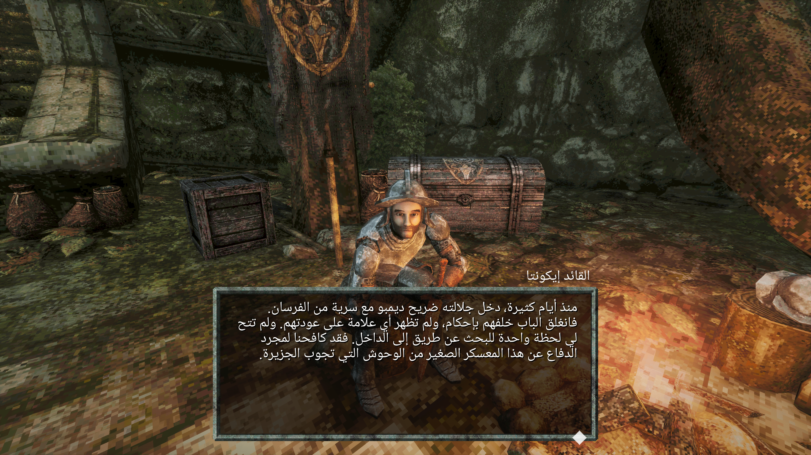
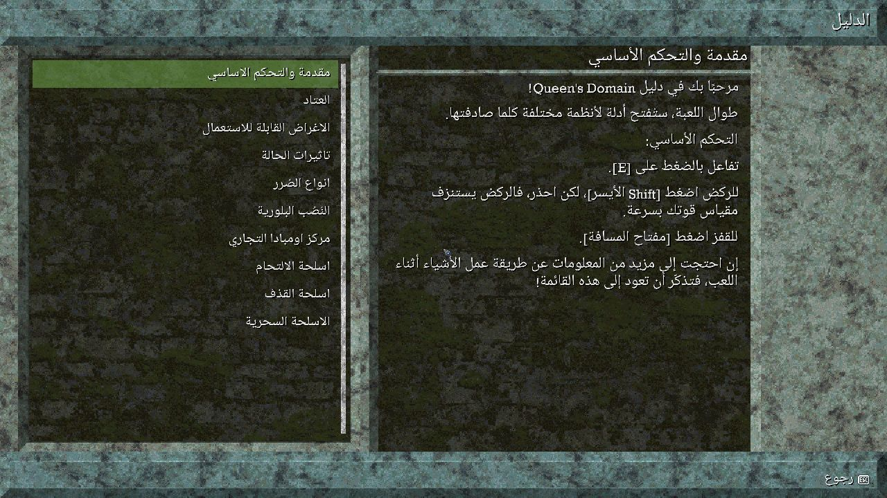
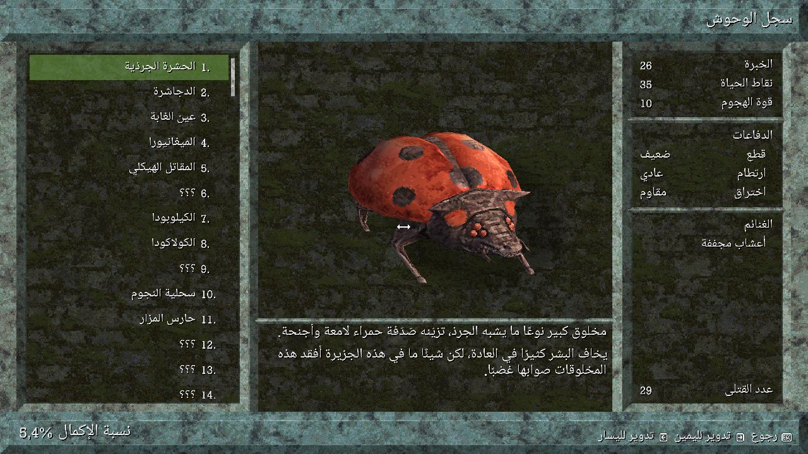
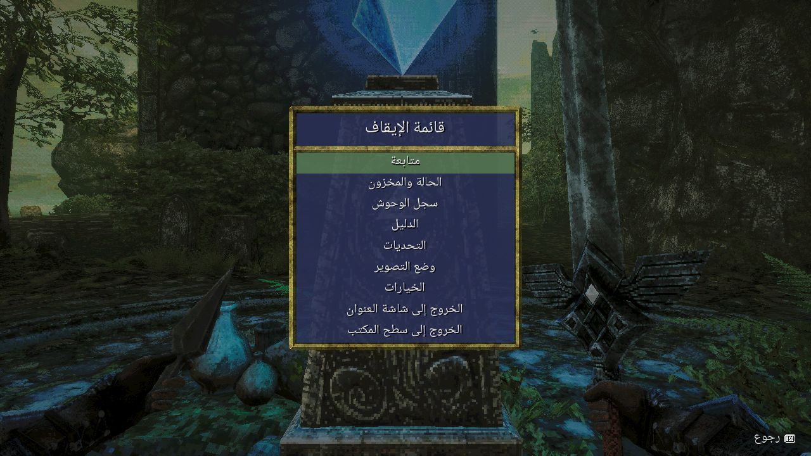

<div dir="rtl">

# Queen's Domain — التعريب العربي

**من تطوير MIZO و ABDULAZIZ** · الإصدار المستقر <bdi>1.3.2</bdi> · مجاني للجميع
 [دليل التثبيت](docs/INSTALL_AR.md) · [الإبلاغ عن مشكلة](https://github.com/MIZO-GAKI/QueensDomain-Arabic/issues/new/choose) · [Nexus Mods](https://www.nexusmods.com/queensdomain/mods/12)

نقدّم لكم التعريب العربي للعبة <bdi>Queen's Domain</bdi>، لنشارككم عالمها وحواراتها باللغة العربية مع الحفاظ على أجوائها الأصلية. يشمل العمل ترجمة النصوص وتحسين عرض العربية داخل الواجهات، من اتصال الحروف واتجاه القراءة إلى مواضع الأسماء والأيقونات.

نواصل تحسين المشروع بالاختبار ومعالجة الملاحظات. **تم تطوير التعريب بواسطة MIZO و ABDULAZIZ.**

## ✦ ما الذي يقدّمه التعريب؟

- **2,382 نصًا مترجمًا** ضمن جرد الترجمة: الحوارات والقوائم وأسماء العناصر والمعدات وأوصافها والدليل وسجل الوحوش والكتب والنصوص القصصية.
- خط عربي مع دعم اتصال الحروف، وتحسينات لمحاذاة النصوص وقراءتها من اليمين إلى اليسار.
- ترتيب عربي لصفوف المخزون والمتجر والمعدات، مع فصل الأعداد والأسعار عن الأسماء.
- تحسين عرض النصوص الطويلة، وخيارات الحوار، وبيانات الحفظ، وقائمة الإيقاف.
- خيار إضافي لظهور الحروف العربية تدريجيًا من اليمين إلى اليسار، **عند توافق الملف التنفيذي**.
- الإبقاء على تفاعلات اللعبة ورموز لوحة المفاتيح ووحدة التحكم؛ اختبارات اللعب الحالية أُجريت بلوحة المفاتيح، ولم يُختبر كل وضع بوحدة تحكم فعلية.

هذا تعديل غير رسمي. عدد النصوص يعكس جرد الترجمة المفحوص، وليس ادعاءً باختبار كل مشهد أو حالة داخل اللعبة. [نتائج الاختبار وحدوده](docs/VALIDATION.md).

## ↓ التحميل

اختر **حزمة واحدة** من الإصدار <bdi>1.4.0</bdi>:

### [النسخة الكاملة — تثبيت تلقائي](https://github.com/MIZO-GAKI/QueensDomain-Arabic/releases/download/v1.4.0/QueensDomain-Arabic-v1.4.0-Full-Installer.zip)

المثبّت يبحث عن اللعبة، يحفظ نسخة من التعريب السابق، ويعرض خيار الظهور التدريجي عندما يتوافق ملف التشغيل. إن لم يتوافق، يثبّت نسخة العرض الكامل تلقائيًا دون تعديل الملف التنفيذي.

### [النسخة اليدوية — ملف PAK فقط](https://github.com/MIZO-GAKI/QueensDomain-Arabic/releases/download/v1.4.0/QueensDomain-Arabic-v1.4.0-Manual-PAK.zip)

انسخ ملف التعريب إلى مجلد اللعبة دون تشغيل مثبّت. **هذه النسخة لا تدعم الظهور التدريجي للحروف العربية من اليمين إلى اليسار؛ يظهر نص الحوار كاملًا مع تلاشٍ لطيف.** للحصول على الظهور التدريجي، استخدم النسخة الكاملة وخيارها المخصص على ملف تشغيل متوافق.

 · [جميع الإصدارات](https://github.com/MIZO-GAKI/QueensDomain-Arabic/releases) · [صفحة Nexus Mods](https://www.nexusmods.com/queensdomain/mods/12)

### أي نسخة أختار؟

| الميزة | النسخة الكاملة | النسخة اليدوية |
| --- | --- | --- |
| طريقة التثبيت | تشغيل <bdi><code>install.bat</code></bdi> | نسخ <bdi><code>PAK</code></bdi> |
| النصوص والواجهات العربية | متاحة | متاحة |
| الظهور التدريجي من اليمين | اختياري؛ يتطلب <bdi>EXE</bdi> متوافقًا | غير متاح؛ عرض كامل مع تلاشي |
| تعديل ملف التشغيل | فقط عند اختيار الميزة وتوافق البصمة | لا |
| سهولة التثبيت | بحث تلقائي وإرشادات | نسخ ملف واحد |
| الإزالة | <bdi><code>uninstall.bat</code></bdi> | حذف ملف التعريب فقط |

## صور من التعريب

### قبل التعريب وبعده

مقارنات فعلية أرسلها فريق التعريب: **الإنجليزية قبل التعريب** بجانب **العربية بعده**. الصور الأصلية بدقة 3840×2160، منشورة دون تغيير. اضغط على أي صورة لفتحها بحجمها الكامل، خصوصًا على الهاتف.

### المتجر

<table dir="ltr">
<tr><th width="50%" dir="rtl">قبل التعريب — الإنجليزية</th><th width="50%" dir="rtl">بعد التعريب — العربية</th></tr>
<tr>
<td><a href="docs/images/comparison/merchant-before.png"></a></td>
<td><a href="docs/images/comparison/merchant-after.png"></a></td>
</tr>
</table>

### المخزون والمعدات

<table dir="ltr">
<tr><th width="50%" dir="rtl">قبل التعريب — الإنجليزية</th><th width="50%" dir="rtl">بعد التعريب — العربية</th></tr>
<tr>
<td><a href="docs/images/comparison/inventory-before.png"></a></td>
<td><a href="docs/images/comparison/inventory-after.png"></a></td>
</tr>
</table>

### الحوار

<table dir="ltr">
<tr><th width="50%" dir="rtl">قبل التعريب — الإنجليزية</th><th width="50%" dir="rtl">بعد التعريب — العربية</th></tr>
<tr>
<td><a href="docs/images/comparison/dialogue-before.png"></a></td>
<td><a href="docs/images/comparison/dialogue-after.png"></a></td>
</tr>
</table>

[فتح معرض المقارنة كاملًا](docs/COMPARISON.md)

<details>
<summary>صور إضافية: الدليل وسجل الوحوش وقائمة الإيقاف</summary>

لقطات فعلية من اختبارات الإصدار؛ دقة هذه اللقطات المنشورة تختلف عن دقة التصيير داخل اللعبة.







</details>

## التثبيت السريع

**بالنسخة الكاملة:** أغلق اللعبة، وفك الضغط في مجلد عادي، ثم شغّل <bdi><code>install.bat</code></bdi>. اختر مجلد اللعبة إن طُلب، وحدد خيار الظهور التدريجي إن كان متاحًا. شغّل اللعبة واختر **الخيارات ← اللغة ← العربية**.

**بالنسخة اليدوية:** فك الضغط وانسخ الملف التالي إلى المسار الموضح داخل مجلد تثبيت اللعبة:

</div>
<div dir="ltr">

```text
QueensDomain/Content/Paks/zz_QueensDomain_Arabic_P.pak
```

</div>
<div dir="rtl">

لا تضع ملف ZIP داخل مجلد اللعبة، ولا تثبّت النسختين معًا. عند الانتقال من تعديل EXE السابق إلى النسخة اليدوية، شغّل المثبّت واختر «لا» أولًا لاستعادة ملف التشغيل المتوافق إلى أصله.

**الإزالة:** شغّل <bdi><code>uninstall.bat</code></bdi> للنسخة الكاملة، أو احذف <bdi><code>zz_QueensDomain_Arabic_P.pak</code></bdi> للنسخة اليدوية. لا تحذف حزمة اللعبة الأصلية. المثبّت لا يعدّل ملفات الحفظ أو إعدادات اللاعب.

[خطوات التثبيت والتحديث والاستعادة بالتفصيل](docs/INSTALL_AR.md) · [English installation guide](docs/INSTALL_EN.md)

## التوافق والمشكلات الشائعة

يقبل المثبّت أرقام إصدارات اللعبة المختلفة على Windows، مع بنية المجلدات الحالية. **قبول التثبيت لا يضمن توافق الواجهات مع كل تحديث للعبة.** اختُبر العرض على <bdi>Steam build 13480 / game 1.01.05 / UE 4.27.2</bdi>.

تعديل EXE الاختياري لا يعمل إلا عند تطابق بصمة الملف مع النسخة المعروفة. يُنشئ المثبّت نسخة احتياطية قبل التعديل ويتحقق من النتيجة. عند اختلاف البصمة يستخدم PAK فقط، دون تجاوز فحص التوافق. لا نوزّع الملف التنفيذي الأصلي.

| المشكلة | ما الذي تراجعه؟ |
| --- | --- |
| العربية لا تظهر | فك الضغط وتحقق من وجود PAK في المسار الصحيح، ثم أعد تشغيل اللعبة وافتح خيارات اللغة. |
| تعارض بعد التحديث | استبدل ملف التعريب السابق بالاسم نفسه؛ لا تحتفظ بنسخ قديمة بأسماء مختلفة داخل مجلد PAK. |
| الظهور التدريجي لا يعمل | النسخة اليدوية تستخدم العرض الكامل؛ الخيار التدريجي يحتاج المثبّت وEXE متوافقًا. |
| المثبّت يتوقف | أغلق اللعبة، وتحقق من المسار واكتمال الحزمة. راجع دليل التثبيت لمعرفة سجل الخطأ. |
| مشكلة في المحاذاة | أرسل الإصدار وطريقة التثبيت والدقة ونسبة الشاشة وصورة للمشكلة عبر Issues. |

لا تعطّل برنامج الحماية ولا تتجاوز تحذيراته. [المساعدة التفصيلية](docs/INSTALL_AR.md).

## الفريق والحقوق

- **MIZO — Arabic Localization Developer**
- **ABDULAZIZ — Arabic Localization Developer**

اللعبة وأصولها ولقطات اللعب لأصحاب حقوقها. خط <bdi>Noto Naskh Arabic UI</bdi> من Google، بترخيص <bdi>SIL Open Font License 1.1</bdi>؛ [نص الترخيص](LICENSES/OFL-NotoNaskhArabicUI.txt).

المصدر متاح للمراجعة والشفافية؛ لم تُحدّد رخصة مفتوحة للمشروع، ولا تمنح إتاحته ترخيصًا لإعادة استخدام أصول اللعبة. [تفاصيل الحقوق والمكوّنات](THIRD_PARTY_NOTICES.md).

## ❤️ ادعم استمرار التعريب

تطوير التعريب يحتاج وقتًا في الترجمة والبرمجة والاختبار والتحسين. دعمكم يشجّعنا على معالجة المشكلات ومواصلة العمل على تجارب عربية وألعاب جديدة.

يمكنكم دعمنا **بنجمة على GitHub**، ومشاركة التعريب مع أصدقائكم، و[الإبلاغ عن الأخطاء](https://github.com/MIZO-GAKI/QueensDomain-Arabic/issues/new/choose)، وتقديم الاقتراحات. حتى الملاحظات الصغيرة تساعدنا على تحسين المشروع.

لمن يرغب في الدعم المادي الاختياري: لا توجد حاليًا وسيلة دعم مادي مفعّلة لهذا المستودع. سنضيف رابطًا معتمدًا عند تهيئته. **التعريب مجاني للجميع؛ الدعم اختياري تمامًا ولا يؤثر على التحميل أو التحديثات.**

شكرًا لكل من يساهم في نشر المحتوى العربي في عالم الألعاب.

**MIZO & ABDULAZIZ**

---

[سجل التغييرات](CHANGELOG.md) · [المساهمة](CONTRIBUTING.md) · [مصدر وأدوات البناء](source/BUILD.md) · [Nexus Mods](https://www.nexusmods.com/queensdomain/mods/12)

</div>
